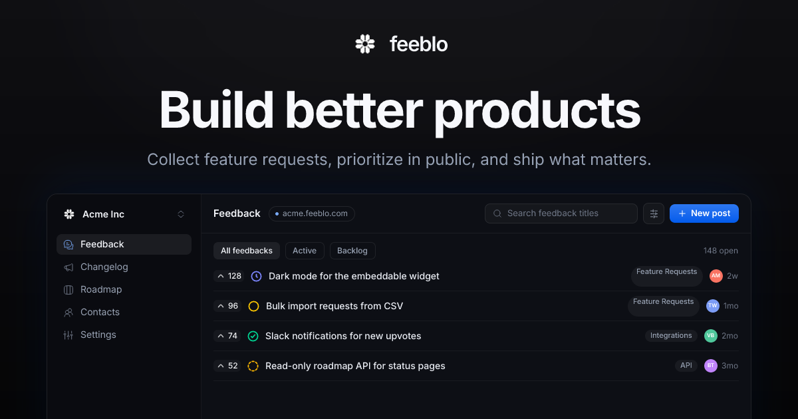

# Feeblo



Open-source customer feedback platform. Teams collect feature requests on boards, prioritize them in public, publish a roadmap and changelog, and embed the feedback widget in their own product. Agents and scripts reach the same workspace through the Public API and its MCP projection.

Built as a pnpm + Turborepo monorepo with [Effect](https://effect.website), [Drizzle](https://orm.drizzle.team), and [TanStack Start](https://tanstack.com/start). Licensed under the [GNU AGPL-3.0](./LICENSE).

## What it includes

- Feedback boards with posts, comments, voting, tags, statuses, assignees, and saved views.
- A public roadmap, changelog with RSS, and post pages, with generated Open Graph images.
- An embeddable widget with ESM and UMD builds, React bindings, hub modes, and JWT SSO for signed-in users.
- Workspace insights over 7, 30, or 90 day windows, plus CSV import and export.
- Slack, Discord, GitHub, and signed webhook integrations, with durable outbound delivery and retries.
- A versioned Public API, and the same operations as MCP tools that accept either an API key or OAuth.
- In-app and email notifications, email suppression and bounce handling, and Polar billing.

## Monorepo layout

```
apps/
  server/               Effect HTTP API: RPC, Public API, MCP, integration providers
  web/                  Dashboard and public portal (TanStack Start, React); Cloudflare or Docker
  public-feature-board/ Public portal UI and collections: boards, roadmap, changelog
packages/
  auth/                 better-auth wiring, organization ACL, API-key plugin
  config/               Shared tsconfig base and Effect Config helpers
  db/                   Drizzle schema, migrations, PGlite test database, seed/nuke
  db-migrator/          Standalone migration runner for deployments
  domain/               Domain behavior: schemas, repositories, RPC contracts, handlers
  domain-contracts/     Schemas and vocabularies both browser and server may import
  feedback-widget/      SolidJS iframe widget bundle
  id/                   Branded identifier types
  permissions/          Member permission catalog
  post-ui/              Post, comment, and roadmap surface shared by dashboard and portal
  rpc-client/           Effect RPC client
  sdk/                  Published SDK (ESM + UMD)
  sdk-react/            Published React bindings for the SDK
  transactional/        Email templates and mailer
  ui/                   Shared UI primitives
  utils/                Shared primitives, including runtime type guards
  web-shared/           Browser-side shared code: collections, auth context, error parsing
integrations/
  core/                 Provider registry, delivery worker, credential encryption
  webhook/              Signed webhooks
  slack/ discord/       Chat providers
  github/               Issue tracker provider
tools/                  Oxlint plugin and test runners
e2e/                    Playwright end-to-end suite
docker/                 Local development infrastructure
docs/                   Topic docs and docs/adr/ decision records
```

## Tech stack

- **Runtime/Server:** Node 26, Effect v4, `@effect/platform-node`, `@effect/sql-pg`
- **Database:** PostgreSQL with pgvector via Drizzle ORM; PGlite (`@effect/sql-pglite`) for tests
- **Auth:** better-auth, with Polar for billing
- **Web:** TanStack Start, React 19, TanStack Router/DB/Query/Form, Tailwind v4
- **Widget:** SolidJS, Vite-built, Floating UI positioning
- **State:** XState 6
- **Observability:** OpenTelemetry over OTLP, Sentry for errors, Databuddy for product analytics
- **Tooling:** pnpm 11, Turborepo, tsrs (a Rust port of TypeScript 7), Oxlint + Oxfmt (type-aware via `@effect/tsgo`), Knip, Vitest, Playwright
- **Infra/Deploy:** Docker, Cloudflare via Wrangler

## Prerequisites

- Node.js `^26.4.0`
- pnpm `^11.0.3`
- Docker (for local Postgres, Redis, MinIO, and mail) — optional but recommended

## Getting started

1. Install dependencies:

   ```sh
   pnpm install
   ```

   `prepare` runs `effect-tsgo patch` here, which wires the Effect language service into the `tsrs` compiler and Oxlint. If Effect diagnostics never appear later, that step did not run.

2. Copy the environment file and fill in values:

   ```sh
   cp .env.example .env
   ```

   Required configuration includes `DATABASE_URL`, `AUTH_ENCRYPTION_KEY`, `APP_URL`, `API_URL`, `APP_ROOT_DOMAIN`, SMTP settings, and media upload (S3-compatible) settings. See `.env.example` for details.

3. Start local infrastructure and run migrations plus seed:

   ```sh
   pnpm db:start
   pnpm db:migrate
   pnpm db:seed
   ```

   `pnpm db:start` brings up `docker/docker-compose.dev.yml`: Postgres on **54323**, Redis on **63799**, Mailpit on 8025/1025, and MinIO on 9001/9002. Those ports are deliberate — they are non-standard so the stack can coexist with a system Postgres or Redis, and `.env.example` is written against them. Do not expect 5432.

   Both compose files pin the same `container_name`s, so the dev stack and the production stack in `docker-compose.yml` cannot run at once. If you have started the root one, `docker compose down` from the repo root first.

4. Run the dev servers (API and web in parallel via Turbo):

   ```sh
   pnpm dev
   ```

   Or run them individually:

   ```sh
   pnpm dev:server   # API on http://localhost:3000
   pnpm dev:web      # Dashboard on http://localhost:3001
   ```

   Public boards answer on workspace subdomains of `APP_ROOT_DOMAIN`, such as `acme.localhost:3001`.

## Quality gate

```sh
pnpm check
```

That runs the toolchain guard, every package's `tsrs --noEmit`, type-aware Oxlint, the formatter check, and Knip. It needs no database, no build output, and no env file, and CI runs it on every push. Run it before opening a pull request.

`AGENTS.md` is the repo law: commands, architecture, and the changes that need an owner decision. `CONTEXT.md` fixes the product's vocabulary. `docs/adr/` records why specific boundaries exist. See [Documentation](#documentation) for the topic guides.

## Common scripts

| Script | Description |
| --- | --- |
| `pnpm dev` | Run all dev tasks across the workspace |
| `pnpm dev:server` / `pnpm dev:web` | Run the API or the dashboard |
| `pnpm build` | Build all packages and apps |
| `pnpm check` | The gate: toolchain, typecheck, lint, format check, and Knip |
| `pnpm typecheck` | Types only, cached per package |
| `pnpm knip` | Unused files, dependencies, and exports |
| `pnpm toolchain` | Check that the Effect and compiler version trains agree |
| `pnpm test` | Unit tests (`@feeblo/e2e` excluded) |
| `pnpm test:e2e` | Playwright end-to-end suite |
| `pnpm lint` / `pnpm lint:fix` | Lint and format check / autofix |
| `pnpm fmt` / `pnpm fmt:check` | Format / verify formatting only |
| `pnpm db:start` | Start local Postgres, Redis, Mailpit, and MinIO |
| `pnpm db:stop` / `pnpm db:down` | Stop / tear down the local stack |
| `pnpm db:watch` | Same as `db:start`, in the foreground |
| `pnpm db:push` | Push schema to the database |
| `pnpm db:generate` | Generate SQL migrations from schema changes |
| `pnpm db:migrate` | Run pending migrations |
| `pnpm db:seed` | Seed the database with sample data |
| `pnpm db:studio` | Open Drizzle Studio |
| `pnpm db:nuke` | Drop and recreate the database |
| `pnpm db:configure-embeddings` | Set the post embedding vector size (default 1536) |

## Documentation

- [Public API and MCP](./docs/public-api.md)
- [Integrations](./docs/integrations.md)
- [Webhooks](./docs/webhooks.md)
- [Notifications](./docs/notifications.md)
- [Permissions](./docs/permissions.md)
- [CSV import and export](./docs/data-transfer.md)
- [Widget SSO](./docs/widget-sso.md)
- [Telemetry](./docs/telemetry.md)
- [i18n](./docs/i18n/README.md)
- [Architecture decisions](./docs/adr/)

## Feedback widget SDK

The embeddable SDK lives in `packages/sdk` and ships ESM + UMD builds, with React bindings in `packages/sdk-react`. See [`packages/sdk/README.md`](./packages/sdk/README.md) and [`packages/sdk-react/README.md`](./packages/sdk-react/README.md) for installation and usage. Release steps are in [`docs/sdk-releases.md`](./docs/sdk-releases.md).

## Billing

Billing uses Polar. Set `POLAR_MODE`, `POLAR_ACCESS_TOKEN`, and `POLAR_WEBHOOK_SECRET` to enable checkout, subscription synchronization, and the customer portal.

Configure the Polar webhook URL as:

```text
https://<API_URL>/api/auth/polar/webhooks
```

Each recurring product must include metadata that identifies its entitlement plan and billing variant:

```json
{ "plan": "starter", "variant": "monthly" }
```

Supported plan values are `starter` and `professional`; supported variants are `monthly` and `yearly`. The variant must match the product's recurring interval. Products without valid metadata, archived products, and one-time products are rejected by the checkout API.

After adding the webhook to an existing Polar organization, resend `product.created` or `product.updated` events for the current products so the local product catalog is populated before enabling billing.

The workspace a subscription belongs to is the `metadata.org` value on the checkout, not the Polar customer. Polar resolves a checkout customer by email and allows one customer per email per organization, so a buyer who pays for several workspaces shares one Polar customer and one portal. Deleting an account never deletes a Polar customer for that reason; a deleted workspace's subscription is queued and revoked with retries (see `docs/adr/0013` and `docs/adr/0014`).

Polar also caps a customer at one billable subscription unless the organization enables **Settings → Subscriptions → Allow multiple subscriptions**. Because the customer is resolved by email, that default caps a buyer across workspaces: a person who already pays for one workspace cannot check out a second one, and Polar refuses on its hosted checkout page after Feeblo has handed the buyer off. Enable the setting on any deployment where one person may pay for more than one workspace; the server logs a warning at startup when the token's organization has it off (see `docs/adr/0015`).

## Deployment

Production deployments use the Docker images referenced in `docker-compose.yml` (`ghcr.io/g3root/feeblo-server` and `ghcr.io/g3root/feeblo-web`). Images are published automatically to GHCR: pushes to `main` produce `edge` and `sha-*` tags, while version tags produce the release version, `major.minor`, `major`, and `latest` tags. The dashboard can alternatively be deployed to Cloudflare using the Wrangler configuration in `apps/web/wrangler.jsonc`.

### Self-hosting

The compose stack uses its own operator file. The development `.env` is not valid for it: its `DATABASE_URL` and `REDIS_URL` point at host ports that do not exist inside the containers.

```sh
test -f docker/.env.selfhost || (umask 077 && cp docker/.env.selfhost.example docker/.env.selfhost)
chmod 600 docker/.env.selfhost
$EDITOR docker/.env.selfhost
docker compose --env-file docker/.env.selfhost up -d
```

The stack expects HTTPS hostnames (the session cookie is `Secure`), a working SMTP server (account verification sends a code by email), and S3-compatible object storage. See [docs/self-hosting.md](./docs/self-hosting.md) for DNS and TLS, reverse-proxy trust, OAuth callbacks, public-board subdomains, upgrades, and backups.

The Cloudflare Worker is built from the `prod` branch, which only ever moves forward to a release tag: run the **Promote prod** workflow with the tag name (Actions → Promote prod → Run workflow), which checks first and does nothing else while **dry run** is checked, then run it again with that box cleared to move the branch. From a terminal that is `gh workflow run promote-prod.yml -f tag=v1.2.0 -f dry_run=true`, then the same command with `-f dry_run=false`; the tag must have a published Release, because the Docker images are published from that event. `prod` is never merged into and never force-pushed; see `docs/adr/0018`.

Production startup enforces two safety checks: `AUTH_ENCRYPTION_KEY` must be at least 32 bytes, and `REDIS_URL` must be set so rate limits are shared across server instances.

The Compose database uses the pgvector-enabled PostgreSQL image. Post embeddings default to OpenAI `text-embedding-3-small` at 1536 dimensions. Set `EMBEDDING_API_KEY` to enable embeddings; OpenAI-compatible self-hosted providers can also set `EMBEDDING_API_URL`, `EMBEDDING_MODEL`, and `EMBEDDING_DIMENSIONS`.

When changing to a model with a different vector size, reconfigure the database column from the published server image before restarting it:

```sh
docker compose --env-file docker/.env.selfhost run --rm server \
  node ./migrate/configure-embeddings.js \
  --dimensions 768 \
  --clear-existing
```

The command clears incompatible vectors and rebuilds the HNSW index. Omit `--clear-existing` to make it fail safely when existing vectors would be lost. For a local database, run the same command through `pnpm db:configure-embeddings --dimensions 768 --clear-existing`.

## License

Copyright © Feeblo contributors. Distributed under the [GNU Affero General Public License v3.0](./LICENSE).
